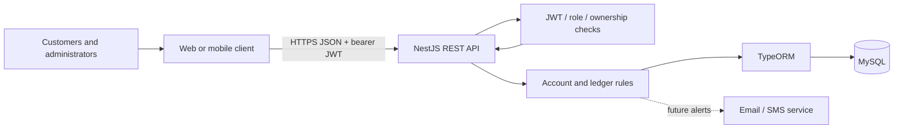
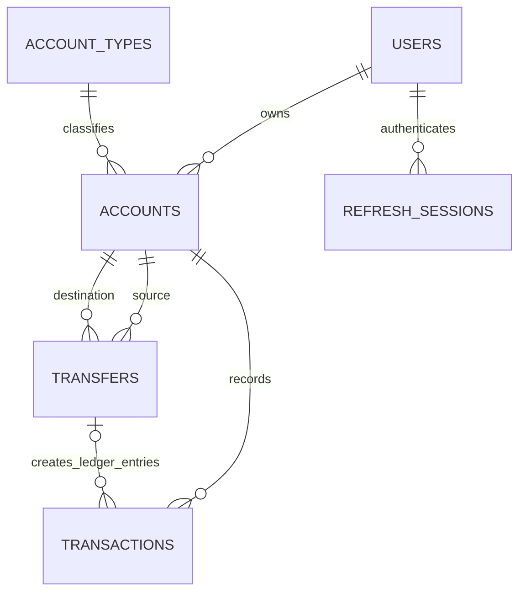

# Architecture, database relationships and API rules

## System architecture

For a transfer, the API identifies both accounts, locks them in ascending account-ID order, verifies ownership, account status, the source minimum balance and destination balance limit, then records the debit, credit, transfer and two ledger entries in a single database transaction. Any exception rolls everything back.

## ERD

## Data dictionary assumptions

The bank portion of the supplied Lab 04 pages shows `User`, `AccountType`, `Account`, `Transaction`, and `Transfer`. The PDF also contains unrelated marketplace page images (including Listing, PurchaseOrder and Delivery fields); those are excluded. The bank API draft supplies the following field names and shapes, while noting some examples are provisional:

| Entity | Fields represented |
|---|---|
| User | userId, fullName, email, passwordHash, role, isActive, createdAt, updatedAt |
| AccountType | accountTypeId, typeName, minimumBalance, interestRate |
| Account | accountId, userId, accountTypeId, accountNumber, balance, status, openedAt |
| Transaction | transactionId, accountId, transactionType, amount, description, transactionDate |
| Transfer | transferId, sourceAccountId, destinationAccountId, amount, status, transferredAt |

Implementation additions: an optional `transfer_id` on transaction rows ties the paired transfer ledger entries together, and `refresh_sessions` stores hashed refresh-token sessions for rotation/revocation. Monetary values use `DECIMAL(15,2)` and API decimal strings. The user ID uses auto-increment `INT`, matching the visible bank ERD, although Lab 06 also mentions UUID as an alternative.

## Access rules

| API group | Customer | Admin |
|---|---|---|
| Auth register/login/refresh/logout | Allowed | Allowed |
| Users list/create/update | Denied | Allowed |
| Account types list/read | Allowed | Allowed |
| Account type create/update/delete | Denied | Allowed |
| Accounts and nested transactions | Own accounts | All accounts |
| Transactions | Own accounts | All accounts |
| Transfers | Transfers involving owned accounts | All transfers |

The API denies access by default. A user's own account is identified by comparing `accounts.user_id` with the verified JWT subject. No client-supplied `userId` is accepted for account creation; balance changes must go through transaction or transfer routes. A valid login without permission returns 403; missing, invalid or expired access JWT returns 401.

## Ledger rules

- Deposit and withdrawal: lock account row, check account is Active, check positive amount and two decimal places; withdrawal must leave at least `minimumBalance`; update balance and save ledger record together.
- Transfer: lock both account rows in ascending ID order, reject same-account transfers and inactive accounts, require source ownership, enforce source minimum and destination `DECIMAL` maximum, then commit source/destination changes, transfer, and TransferOut/TransferIn ledger rows together.
- Completed transfers are immutable and have no update/delete endpoint. Account types cannot be deleted while referenced. Accounts and financial ledger records are retained for audit.

## Token and password controls

Access token lifetime defaults to 15 minutes. Refresh tokens live for 7 days, are stored as SHA-256 digests, rotate on refresh and are revoked at logout. Passwords are bcrypt hashed with cost 12; the starter checks 12-character minimum, mixed case and a digit, and rejects a short common-password sample list. A production breach-password service and MFA still need to be added.
